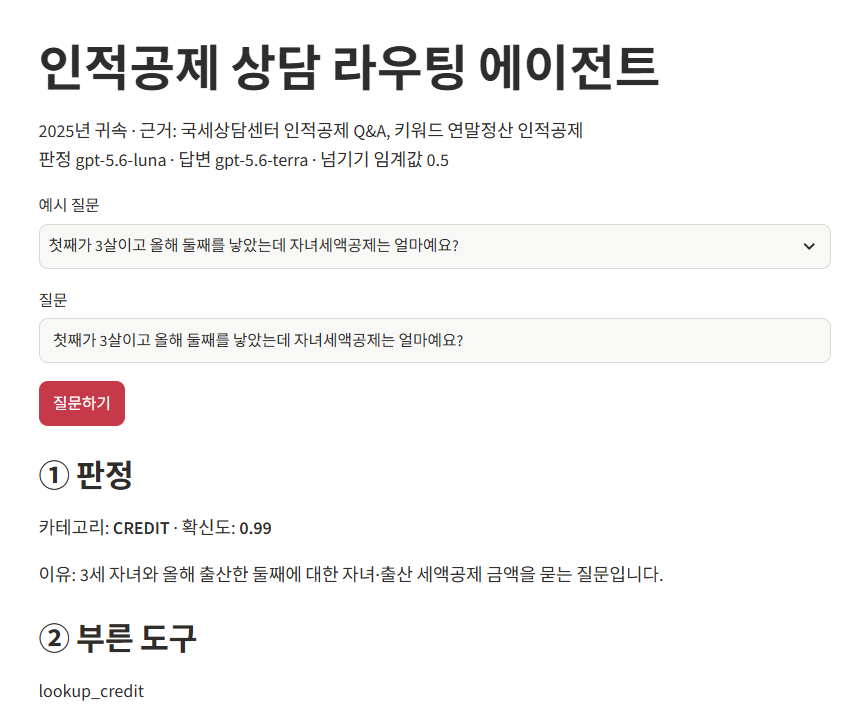

# 인적공제 상담 라우팅 에이전트

2025년 귀속 인적공제 질문을 카테고리(`FAMILY`·`INCOME`·`EXTRA`·`CREDIT`·`OTHER`)로 먼저 나누고, 그 카테고리에 연결된 자료 부분만 근거로 답하며, 근거에 없는 숫자·근거 번호가 섞이면 다시 답하게 하거나 상담원에게 넘기는 LangGraph 에이전트입니다.

모두의연구소 「고객 응대 에이전트 만들기 — 라우팅과 그라운딩」 10장 실습 프로젝트 과제입니다.

**보고서: [REPORT.md](REPORT.md)** · 설계 문서: [PRD.md](PRD.md)

```
질문 → ① 카테고리 판정 → ② 카테고리별 근거 조립 → ③ 근거만으로 답변 → ④ 검증
              ↓ (OTHER·확신도 0.5 미만·근거에 답 없음·검증 위반)
           상담원에게 넘기기
```

## 결과 요약

평가용 22건(RAG 과제 고정 질문 11개 포함). 판정 `gpt-5.6-luna`, 답변·채점 `gpt-5.6-terra`.

| 지표 | 기준 실행 | 개선 1 |
|---|---|---|
| 분류 정확도 / macro F1 | 1.000 / 1.000 | 1.000 / 1.000 |
| 도구 호출 적절성 | 0.955 | 1.000 |
| 답변 적절성 | 0.909 | 0.955 |

채점기 검증: 모범 답안 18/18 통과, forbid 오답 18/18 탈락. 틀린 건 원인과 개선 기록은 [REPORT.md](REPORT.md) 4절.

## 파일

| 파일 | 내용 |
|---|---|
| [docs/](docs) | 근거 문서: 국세상담센터 인적공제 Q&A, 키워드 연말정산 인적공제, 고친곳.md |
| [data/goldenset.json](data/goldenset.json) | 평가셋 (평가용 22건 + 예시용 5건) |
| [context.py](context.py) | 문서 쪼개기, 카테고리 ↔ 문서 매핑표, 카테고리별 근거 조립 |
| [prompts.py](prompts.py) | 분류 지침, 답변 규칙, 채점 지침 |
| [agent.py](agent.py) | 파이프라인 (LangGraph), 코드 검증(가드레일) |
| [evaluate.py](evaluate.py) | 채점기 검증 + 분류·도구·답변 지표 측정 |
| [app.py](app.py) | 데모 화면 (Streamlit) |
| [results/](results) | 측정 기록 |

## 실행

```
pip install -r requirements.txt
```

이 폴더에 `.env` 파일을 만들고 `OPENAI_API_KEY=...`를 넣습니다. (`.env`는 저장소에 올리지 않습니다.)

```
python evaluate.py --note "메모"
```

```
streamlit run app.py
```


