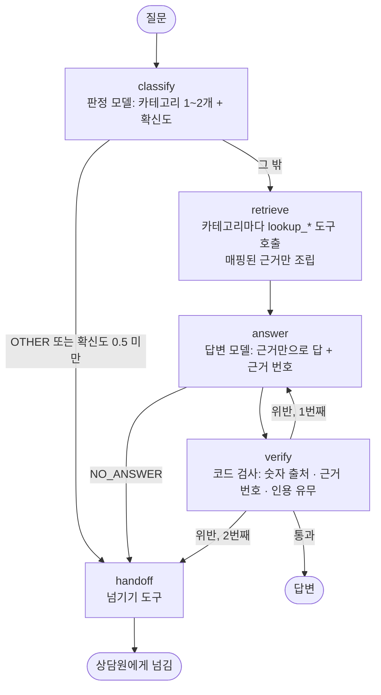
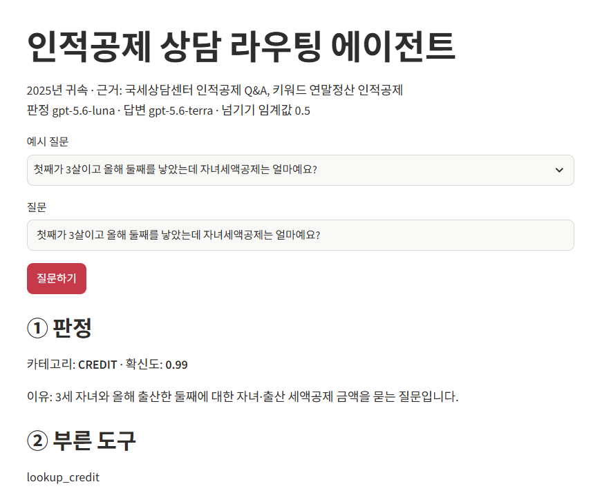
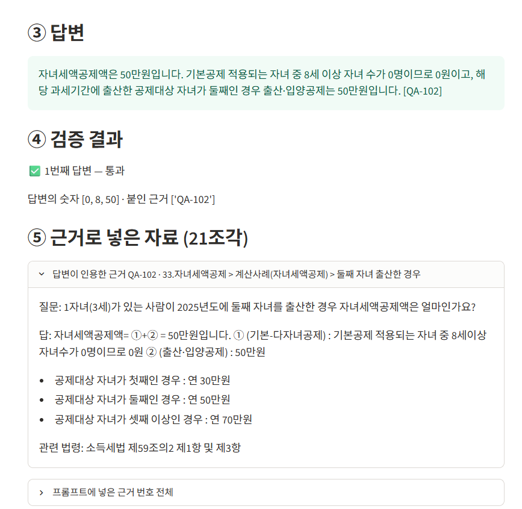

# REPORT — 인적공제 상담 라우팅 에이전트

2025년 귀속 인적공제 질문을 카테고리별로 나누고, 그 카테고리에 연결된 자료 부분만 근거로 답하며, 근거에 없는 숫자·번호가 섞이면 내보내지 않는 에이전트. 설계 문서: [PRD.md](PRD.md)

## 1. 주제와 근거 문서

- 주제: 종합소득세·연말정산에서 "이 가족을 공제받을 수 있나"를 묻는 인적공제 상담.
- 고른 이유: 이전 RAG 가이드 챗봇 과제에서 같은 자료로 검색형 챗봇을 만들었는데, 자료 전체에서 비슷한 조각을 찾다 보니 관계없는 기준(예: 장애인 형제자매에게 일반 나이요건 적용, 국민연금 600만원을 "공제 가능")을 섞어 답하는 실패가 많았다. 인적공제는 질문 종류(가족 범위 / 소득금액 / 추가공제 / 세액공제)마다 판단 규칙이 달라서, 먼저 나누고 그 부분만 근거로 주는 라우팅 구조가 맞는 주제다.
- 교안의 주제 조건 3가지 확인
  - 카테고리마다 답하는 내용이 다르다: 관계·동거 판단, 소득금액 계산, 추가공제 요건, 세액공제 금액은 각각 다른 규칙이다.
  - 문서가 충분히 길다: 아래 두 자료 합계 약 10만 글자.
  - 그럴듯한 오답이 나오기 쉽다: 경로우대 "65세", 사실혼 배우자 "가능", 국민연금 600만원 "가능" 등.
- 근거 문서 ([docs/](docs))

| 파일 | 내용 | 나누는 단위 | 근거 번호 |
|---|---|---|---|
| 국세상담-인적공제QnA.md | 국세상담센터 자주묻는 Q&A 인적공제, 묶음 13개·질문 107개 | `####` 질문 하나 | QA-001 ~ QA-107 |
| 키워드연말정산-인적공제.md | 2025년 귀속 키워드 연말정산 인적공제 18항목 | `##` 항목 하나 | KW-06 ~ KW-99 (항목 번호) |
| 고친곳.md | 원문 오타·자료끼리 어긋난 곳 8곳을 고친 기록 | - | - |

## 2. 카테고리 설계

자료 자체의 묶음·항목 구분을 기준으로 나눴다. 판단 규칙이 다른 단위끼리 묶었다.

| 카테고리 | 다루는 질문 | 예 |
|---|---|---|
| `FAMILY` 부양가족 범위 | 누가 기본공제 대상 가족인가 (관계·나이·동거·중복공제) | 사실혼 배우자도 되나요? |
| `INCOME` 소득요건 | 가족 소득이 연간소득금액 100만원 이하인가 | 어머니 국민연금 600만원이면? |
| `EXTRA` 추가공제 | 경로우대·장애인·부녀자·한부모 추가공제 | 경로우대는 몇 살부터? |
| `CREDIT` 자녀·출산·혼인 세액공제 | 자녀세액공제, 출산·입양, 혼인세액공제, 자녀보육수당 | 둘째 출산하면 얼마? |
| `OTHER` 범위 밖 | 위 넷이 아닌 것 → 답하지 않고 넘긴다 | 신고 기한, 사업 경비, 의료비 공제, 날씨 |

매핑표 ([context.py](context.py)의 `MAPPING`)

| 카테고리 | 국세상담 Q&A 묶음 | 키워드 연말정산 항목 | 조각 수 / 글자 수 |
|---|---|---|---|
| `FAMILY` | 09 배우자, 10 부모, 11 자녀, 12 형제자매, 13 위탁아동·수급자, 14 기타 친족 | 19, 23, 24, 28, 31, 34, 39, 63, 84, 98 | 47 / 약 20,700 |
| `INCOME` | ※ 연간소득금액 100만원? | 19 기본공제 | 28 / 약 11,000 |
| `EXTRA` | 15 경로우대, 16 장애인, 17 부녀자, 18 한부모 | 06, 42, 63, 71, 89 | 31 / 약 11,600 |
| `CREDIT` | 06 출산보육수당, 33 자녀세액공제 | 66, 67, 90, 99 | 21 / 약 7,400 |
| `OTHER` | 없음 | 없음 | 0 |

- 키워드 63 인적공제는 기본공제·추가공제 표가 한 항목에 같이 있어서 `FAMILY`와 `EXTRA` 둘 다에 넣었다.
- `INCOME`은 키워드 자료에 전용 항목이 없어 소득금액 요건이 적힌 키워드 19 기본공제를 함께 넣었다.
- 한 질문이 두 카테고리에 걸치면(예: 연금 금액 + 경로우대) 판정이 최대 2개를 고르고, 두 카테고리 근거를 겹치지 않게 합쳐 넣는다.
- 어느 카테고리든 자료 전체(약 10만 글자)가 아니라 매핑된 부분만 프롬프트에 들어간다.

## 3. 평가셋 설계

- 파일: [data/goldenset.json](data/goldenset.json). 평가용 22건, 예시용 5건.
- 평가용 22건 = 카테고리 5개 × 4건 + 두 카테고리에 걸친 질문 2건. RAG 과제의 고정 질문 11개(①~⑪)를 모두 넣었다(`rag` 칸).
- 넘기는 것이 정답인 문항: `OTHER` 4건. 그중 O04(부모님 의료비 세액공제)는 가족 공제처럼 보이지만 인적공제 자료 밖이다.
- 문항마다 적은 것
  - `categories`, `tools`: 정답 카테고리와 기대 도구(`lookup_family` 등, 넘기면 `handoff`)
  - `evidence`: 답이 들어 있는 근거 번호. 질문은 Q&A 원문 질문을 사용자 말투로 바꿔 만들었고, 그 Q&A의 답에서 `must`를 뽑았다.
  - `must`: 반드시 담아야 할 사실
  - `forbid`: 자료를 안 읽었을 때 나오기 쉬운 오답(경로우대 "65세", "2025년 12월 31일 이전 출생", 600만원 "공제 가능", 둘째 출산 "30만원" 등). RAG 과제에서 실제로 나온 오답을 우선 넣었다.
  - `reference`: 모범 답안(채점기 검증용)
- 예시용 5건(카테고리마다 1건, `split: fewshot`)은 판정 프롬프트의 예시로만 쓰고 평가에 쓰지 않는다. 평가 문항과 같은 질문이 예시에 들어가지 않게 했다.

## 4. 측정 결과

측정: [evaluate.py](evaluate.py). 판정 `gpt-5.6-luna`, 답변·채점 `gpt-5.6-terra`, 넘기기 임계값 0.5. 기록 원본은 [results/](results).

### 채점기 검증

채점기는 LLM이 `must` 항목마다 충족 여부, `forbid` 항목마다 위반 여부를 내고, 통과 여부는 코드가 그 항목별 판정으로 다시 계산한다(모든 must 충족 + forbid 위반 없음). 표현이 아니라 사실을 보라고 지침에 적었다.

- 모범 답안 18개 → 18개 통과
- 각 문항의 `forbid` 첫 문장을 그대로 답으로 넣은 오답 18개 → 18개 탈락
- → 채점기가 맞는 답과 틀린 답을 가른다고 보고 이후 측정에 썼다.

### 지표

| 지표 | 기준 실행 | 개선 1 | 통과 기준 |
|---|---|---|---|
| 분류 정확도 | 1.000 | 1.000 | 0.85 |
| 분류 macro F1 | 1.000 | 1.000 | - |
| 도구 호출 적절성 | 0.955 (21/22) | 1.000 (22/22) | 0.8 |
| 답변 적절성 | 0.909 (20/22) | 0.955 (21/22) | 0.7 |
| 검증 후 재생성 / 검증 위반으로 넘김 | 0 / 0 | 0 / 0 | - |

혼동 행렬(두 실행 같음, 행: 정답 주 카테고리, 열: 예측). 두 카테고리 문항은 맨 앞 카테고리로 센다(M01 → INCOME, M02 → FAMILY).

| | FAMILY | INCOME | EXTRA | CREDIT | OTHER |
|---|---|---|---|---|---|
| FAMILY | 5 | 0 | 0 | 0 | 0 |
| INCOME | 0 | 5 | 0 | 0 | 0 |
| EXTRA | 0 | 0 | 4 | 0 | 0 |
| CREDIT | 0 | 0 | 0 | 4 | 0 |
| OTHER | 0 | 0 | 0 | 0 | 4 |

### 틀린 건 원인

| 실행 | 문항 | 틀린 지표 | 무엇이 틀렸나 | 원인 분류 |
|---|---|---|---|---|
| 기준 | C03 손자 자녀세액공제 | 도구 | `CREDIT`에 `FAMILY`까지 골라 근거를 하나 더 조회. 답은 맞음 | 판정: 질문 속 "기본공제 받는"을 가족 범위 질문으로도 읽음 |
| 기준 | E04 암환자 장애인공제 | 답변 | 근거 QA-077의 세 경로(장애인 등록, 발달재활서비스 서류, 의료기관 장애인증명서) 중 증명서 하나만 말함 | 답변: 근거는 맞게 골랐으나 조건을 빠뜨림 |
| 기준 | M02 ⑪ 25세 장애인 동생 | 답변 | 나이 무관·소득 100만원 이하는 맞음. "무엇이 필요한가"에 해당하는 장애인증명서(QA-081)를 빠뜨림 | 답변: 필요한 근거가 프롬프트 안에 있었으나 잇지 못함 |
| 개선 1 | M02 ⑪ | 답변 | 같은 문제 반복. QA-083만 인용 | QA-081은 "중증환자" 묶음 아래에 있고 형제자매라는 말이 없어 질문과 연결되지 않음 |

- 판정 실패는 없었다. 넘겨야 할 4건도 모두 넘겼고, 답한 18건 중 근거에 없는 숫자·번호를 쓴 답은 0건이었다.
- RAG 과제에서 틀렸던 ⑤(600만원), ②(출생연도), ⑩(400만원 + 경로우대)는 모두 통과했다. 카테고리별 근거만 넣자 관계없는 조각을 인용하는 문제가 사라졌다.

### 개선 시도 기록

| 번호 | 바꾼 것 (하나만) | 노린 문항 | 결과 |
|---|---|---|---|
| 기준 | - | - | 도구 0.955, 답변 0.909 |
| 개선 1 | [prompts.py](prompts.py) 답변 규칙에 "질문이 묻는 조건·방법·서류가 근거에 여러 개 있으면 빠짐없이 모두 쓴다. 두 조각 이상에 나뉘어 있으면 모두 찾아 쓴다" 한 줄 추가 | E04, M02 | E04 고쳐짐(세 경로 모두 씀). M02는 그대로. 답변 0.909 → 0.955 |

- 개선 1에서 도구 점수가 1.000이 된 것(C03)은 판정 프롬프트를 바꾸지 않았으므로 개선 효과가 아니라 판정 모델이 실행마다 조금씩 다르게 고른 결과다.
- M02는 규칙 한 줄로 고쳐지지 않는 원인(근거끼리 연결)이라 다음 개선 후보로 남긴다(7절).

## 5. 파이프라인 구조도

[agent.py](agent.py), LangGraph.



상태(State)

| 키 | 채우는 노드 | 내용 |
|---|---|---|
| `question` | 입력 | 사용자 질문 |
| `categories`, `confidence`, `reason` | classify | 판정 결과 |
| `tools_called` | retrieve, handoff | 부른 도구 이름 목록(도구 호출 적절성 채점에 씀) |
| `context`, `chunk_ids` | retrieve | 조립한 근거 본문과 근거 번호 |
| `answer`, `attempts` | answer | 답변과 시도 횟수 |
| `checks`, `problems` | verify | 검증 결과(답변의 숫자, 인용 번호, 위반 내용) |
| `route`, `handoff_reason` | verify, handoff | 답했는지 넘겼는지와 넘긴 이유 |

- 판정과 넘기기 결정을 나눴다: classify는 카테고리와 확신도만 내고, 넘길지는 다음 갈림길(gate)이 임계값으로 정한다.
- 검증(verify)은 모델이 아니라 코드다. 답변 속 10 이상 숫자가 조립한 근거나 질문에 없으면 위반, 답에 붙인 근거 번호가 조립한 근거 밖이면 위반, 번호가 없어도 위반이다. 위반이면 문제를 알려 주고 한 번 다시 답하게 하고, 또 위반이면 넘긴다.

## 6. 데모 설계

[app.py](app.py) (`streamlit run app.py`)




- 처리 순서 그대로 ① 판정(카테고리·확신도·이유) → ② 부른 도구 → ③ 답변 → ④ 검증 결과 → ⑤ 근거 순서로 위에서 아래로 보여 준다. 답이 어디서 왔는지 사람이 따라 읽을 수 있게 하려는 것이다.
- 검증 결과에는 답변 속 숫자와 붙인 근거 번호를 그대로 보여 준다. 위 화면에서 0·8·50이 모두 근거 QA-102에 있는 숫자임을 바로 대조할 수 있다.
- 답변이 인용한 근거 조각은 원문을 펼쳐 볼 수 있고, 프롬프트에 넣은 근거 번호 전체(이 질문은 `CREDIT` 21조각)도 따로 볼 수 있다.
- 넘긴 질문은 노란 상자로 넘긴 이유(범위 밖, 확신도 미달, 근거에 답 없음, 검증 위반)를 함께 보여 준다.
- 처음에는 넓은 화면(wide) 2칸 배치로 만들었으나 넓은 모니터에서 글이 작아 보이고 빈칸이 생겨, 기본 너비 한 줄 배치로 바꿨다.
- 공개 배포는 하지 않았다. API 키는 `.env`에 두고 `.gitignore`로 저장소에서 뺐다.

## 7. 프로젝트 회고

- 가장 공들인 부분: 평가셋의 `forbid`와 채점기 검증. RAG 과제에서 실제로 나온 오답을 `forbid`에 넣고, 모범 답안은 통과·forbid 오답은 탈락하는지 먼저 확인한 뒤에 측정했다. 그래서 점수가 높게 나와도 채점기가 무르게 봐 준 것이 아님을 보일 수 있다.
- 배운 점: 같은 자료로 RAG 과제에서 실패했던 질문들이 "먼저 나누고 그 부분만 준다"는 구조만으로 대부분 풀렸다. 남은 실패는 검색이 아니라 근거 안에서 여러 조각을 잇는 문제였다.
- 보완하고 싶은 점
  - M02처럼 질문이 묻는 것(서류)이 다른 묶음에 있을 때: 장애인증명서 조각(QA-081, QA-085)을 `EXTRA` 안에서 "공통 절차" 조각으로 앞에 두거나, 매핑표를 카테고리 → 묶음이 아니라 카테고리 → 질문 유형(요건 / 절차·서류)으로 한 단계 더 나누기.
  - 판정이 실행마다 2개를 고르기도 하는 흔들림(C03): 같은 평가셋으로 여러 번 재서 평균과 흔들림을 함께 기록하기.
  - 검증의 한계: 숫자가 없는 오답("가능"↔"불가")은 코드 검증으로 못 잡는다. `’24` 같은 줄임 표기를 답이 `2024`로 풀어 쓰면 맞는 답도 위반으로 잡힐 수 있다.
  - 평가셋이 22건으로 작아 분류 1.000은 과대평가일 수 있다. 문항을 늘리고, 자료에 답이 없지만 카테고리 안처럼 보이는 질문을 더 넣어 `NO_ANSWER` 경로를 재야 한다.
  - 계산 도구(소득요건·나이요건 계산)를 넣어 금액 비교와 출생연도 계산을 모델이 아니라 코드가 하게 하기.

## 실행 방법

```
pip install -r requirements.txt
```

`.env`에 `OPENAI_API_KEY=...`를 넣는다.

```
python evaluate.py --note "메모"
```

```
streamlit run app.py
```
